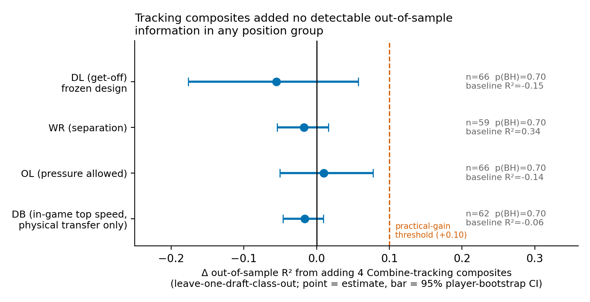

<p align="center">
  
</p>

<h1 align="center">🏈 Does Combine Tracking Add Beyond the Stopwatch?</h1>
<h3 align="center">A Pre-Registered Audit &nbsp;|&nbsp; NFL Big Data Bowl 2027</h3>

<p align="center">
  <em>Held-out draft-class tests across DL, WR, OL and DB find no detectable gain from sensor kinematics — and bound how large any gain could be.</em>
</p>

<p align="center">
  <a href="#key-findings">Key Findings</a> •
  <a href="#motivation">Motivation</a> •
  <a href="#methodology">Methodology</a> •
  <a href="#results">Results</a> •
  <a href="#repo-structure">Repo Structure</a> •
  <a href="#reproduction">Reproduction</a> •
  <a href="#limitations">Limitations</a> •
  <a href="#license">License</a>
</p>

---

## Key Findings

| Position Group | Players | Snaps | Conventional R² | + Tracking R² | Δ R² \[95% CI\] | BH *p* |
|:---:|:---:|:---:|:---:|:---:|:---:|:---:|
| **DL** (get-off) | 66 | 30,191 | −0.152 | −0.207 | −0.056 \[−0.176, +0.057\] | 0.70 |
| **WR** (separation) | 59 | 27,380 | 0.338 | 0.320 | −0.018 \[−0.054, +0.016\] | 0.70 |
| **OL** (pressure allowed) | 66 | 47,835 | −0.140 | −0.130 | +0.010 \[−0.051, +0.078\] | 0.70 |
| **DB** (in-game top speed) | 62 | 24,809 | −0.061 | −0.077 | −0.016 \[−0.046, +0.010\] | 0.70 |

> **Bottom line:** All confidence intervals include zero and lie below the pre-set practical threshold of +0.10 R², meaning a practically useful gain is excluded under this design. This is a *bounded null*, not proof that tracking is worthless.

---

## Motivation

The NFL Scouting Combine records 10 Hz x/y player tracking during every drill — data that captures *how* a prospect moves, not just how long a drill takes. The central question of this project:

> **Does that movement information help predict NFL performance beyond what scouts already have — stopwatch times, body measurements, and draft slot?**

Combine analyses typically test many drill-outcome pairs and report only the survivors. With ≈60 players per position group, that approach is a recipe for false positives. This project takes a different approach: a **pre-registered, auditable design** where hypotheses, features, outcomes, models, and the multiple-testing family were all fixed **before** any association was computed.

---

## Methodology

### Data Pipeline

1. **Combine Tracking → Movement Features** — Raw 10 Hz x/y positions are converted into kinematics (velocity, acceleration, braking, turn rate) using finite differences (not the provided non-negative acceleration magnitude). Four cross-drill composites are computed per player: peak speed, peak acceleration, peak braking, and maximum turn rate.

2. **NFL Game Tracking → Outcomes** — Regular-season, non-nullified plays are linked player-by-player to Combine data. Each position group gets a role/context-adjusted, empirical-Bayes player-level outcome:
   - **DL:** Time to cross the line of scrimmage (get-off), adjusted for alignment, pass/run, and season
   - **WR:** Separation at pass-forward, adjusted for route, alignment, coverage type, cushion, and season
   - **OL:** Pressure allowed vs. expected from a logistic model (alignment, down, distance, formation, coverage, season)
   - **DB:** In-game peak speed during pass coverage (physical-transfer outcome only — the data cannot defensibly link coverage *performance* to a specific defender)

3. **Measurement Validation** — Tracked 40-yard time vs. official stopwatch: *r* = 0.95, *n* = 381 (≈0.13 s offset). Sprint-model top speed correlates with official 40 time at ≈ −0.95, confirming the stopwatch 40 is essentially a top-speed test. In-game tracking-derived first-second advance correlates −0.90 with the NFL's `player_get_off` metric (33,369 DL snaps).

### Statistical Design

- **Pre-registration:** Analysis plans written and SHA-256 hashed before any Combine→outcome association was computed. The analysis script verifies plan hashes at runtime and refuses to run if they've changed.
- **Validation:** Leave-one-draft-class-out (train on 2 classes, predict the 3rd). Ridge regression with inner cross-validated penalty selection.
- **Estimand:** Change in out-of-sample R² from adding tracking composites to the conventional baseline (40, splits, agility, jumps, anthropometrics, log draft pick).
- **Uncertainty:** 95% player-level bootstrap intervals; one-sided permutation test; Benjamini-Hochberg correction across the four position groups.
- **Practical threshold:** A gain of +0.10 R² was pre-set as the minimum for a practically useful finding.

---

## Results

**No position group showed a detectable gain from Combine tracking composites.** All four Δ R² confidence intervals include zero and their upper bounds fall below the +0.10 practical threshold.

### Why the Nulls Differ by Position

<p align="center">
  
</p>

- **WR is the cleanest null.** Conventional measures carry real signal (R² = 0.34; weight *ρ* = −0.62 with separation). Tracking composites are not redundant with the 40 and are reasonably reliable (median retest 0.72) — yet they add nothing.
- **DL:** Speed composite largely duplicates the stopwatch; acceleration/braking features are weakly reliable (median retest 0.36).
- **OL is the least informative test.** The outcome is noisy (split-half reliability 0.40) and tracking features are weakly reliable.
- **DB:** Neither conventional nor tracking measures explain in-game coverage top speed, likely dominated by assignment and scheme.

### Scouting Takeaways

1. Do **not** expect tracked top speed to replace the stopwatch 40 — they carry essentially the same information.
2. Treat single-attempt, drill-level sensor kinematics (acceleration, braking, turning) as **noisy**: 75–83% of drills have only one attempt per player, so reliability can't even be checked.
3. Judge claims of tracking "signals" by **out-of-sample, held-out-class evidence with effect bounds**, not by the best of many correlations.

---

## Repo Structure

```
.
├── README.md
│
├── src/                          # Core library modules
│   ├── combine_40.py             # Mono-exponential sprint model (vmax, tau)
│   ├── features.py               # Combine tracking feature extraction
│   └── multigroup.py             # Multi-group analysis engine (EB, ridge, bootstrap)
│
├── scripts/                      # Reproducible analysis pipeline
│   ├── inspect_data.py           # Initial data exploration
│   ├── build_combine_features.py # Extract kinematic features from Combine tracking
│   ├── build_ingame_dl.py        # Build DL in-game outcome database
│   ├── build_ingame_db.py        # Build DB/WR/OL in-game outcome databases
│   ├── build_outcomes_mg.py      # Construct multi-group EB player outcomes
│   ├── run_analysis_dl.py        # Frozen DL anchor analysis (hash-verified)
│   ├── run_multigroup.py         # Full 4-group confirmatory + sensitivity analysis
│   ├── make_figures_mg.py        # Generate publication figures
│   └── power_followup.py         # Synthetic power/detectability simulation
│
├── tests/                        # Unit and integration tests
│   ├── test_features.py          # Feature extraction tests
│   ├── test_multigroup.py        # Statistical pipeline tests
│   └── test_outcomes_joins.py    # Data join and outcome construction tests
│
├── reports/                      # Analysis outputs and documentation
│   ├── competition_requirements.md
│   ├── data_inventory.md
│   ├── analysis_plan.md          # Pre-specified DL plan (hashed)
│   ├── multigroup_analysis_plan.md # Pre-specified 4-group plan (hashed)
│   ├── plan_hashes.txt           # SHA-256 hashes for auditability
│   ├── results.md                # DL results (frozen anchor)
│   ├── results_multigroup.md     # Full 4-group results
│   ├── results_dl.json           # DL machine-readable results
│   ├── results_multigroup.json   # Multi-group machine-readable results
│   ├── literature_review.md      # Prior work and novelty assessment
│   ├── novelty_matrix.md         # Comparison with competing entries
│   ├── final_research_decision.md
│   ├── limitations.md
│   ├── schema_report.json / schema_tables.md
│   ├── verified_primary_results.md
│   └── figures/
│       ├── fig1_incremental_value.png
│       └── fig2_why_diagnostics.png
│
└── submission/                   # Kaggle submission assets
    ├── writeup_description.md    # Competition writeup (~1,170 words)
    ├── kaggle_form_fields.md     # Submission metadata
    ├── fig1_incremental_value.png
    ├── fig2_why_diagnostics.png
    └── thumbnail_560x280.png
```

---

## Reproduction

### Prerequisites

- Python 3.9+
- NumPy, SciPy, pandas, scikit-learn, matplotlib

### Pipeline

Place the competition data files in a local directory and update the data path in the scripts, then run in order:

```bash
# Step 1: Extract Combine kinematic features
python scripts/build_combine_features.py

# Step 2: Build in-game outcome databases
python scripts/build_ingame_dl.py
python scripts/build_ingame_db.py

# Step 3: Construct multi-group empirical Bayes outcomes
python scripts/build_outcomes_mg.py

# Step 4: Run analyses (plan hashes verified at runtime)
python scripts/run_analysis_dl.py        # DL frozen anchor
python scripts/run_multigroup.py         # Full 4-group analysis

# Step 5: Generate figures
python scripts/make_figures_mg.py

# Step 6 (optional): Power/detectability simulation
python scripts/power_followup.py
```

### Tests

```bash
python -c "import sys; sys.path[:0]=['src','tests']; import test_features; import test_multigroup; import test_outcomes_joins; print('All tests passed')"
```

---

## Limitations

- **Small samples:** ≈60 players per group across 3 draft classes; the 2023 class has up to 3 NFL seasons, the 2025 class only 1.
- **Coarse features:** 4 cross-drill composites only; drill-phase-specific features (e.g., first step, break mechanics) were not tested.
- **Reliability gaps:** 75–83% of drills have a single attempt per player, making test-retest impossible for most kinematic features.
- **Outcome dependence:** WR separation depends on route concept and QB timing; OL pressure depends on scheme; DB outcome is physical, not coverage performance.
- **Selection bias:** Only players with ≥100 qualifying snaps are included (selection into playing time).
- **Power:** A simulation shows even a reliable feature (reliability 0.8) with true incremental R² = 0.10 would be detected only ≈60% of the time at *n* = 66.

See [`reports/limitations.md`](reports/limitations.md) for the full disclosure.

---

## Competition Details

| | |
|---|---|
| **Competition** | [NFL Big Data Bowl 2027](https://www.kaggle.com/competitions/nfl-big-data-bowl-2027) |
| **Theme** | Link Combine sensor tracking to regular-season NFL performance |
| **Deadline** | January 6, 2027, 11:59 PM UTC |
| **Judging** | Football (30%), Data Science (30%), Writeup (20%), Visualization (20%) |
| **Data License** | CC BY-NC 4.0 |

---

## License

This project's code is released under the [MIT License](LICENSE). The underlying NFL data is provided under [CC BY-NC 4.0](https://creativecommons.org/licenses/by-nc/4.0/) and is **not** redistributed in this repository.
