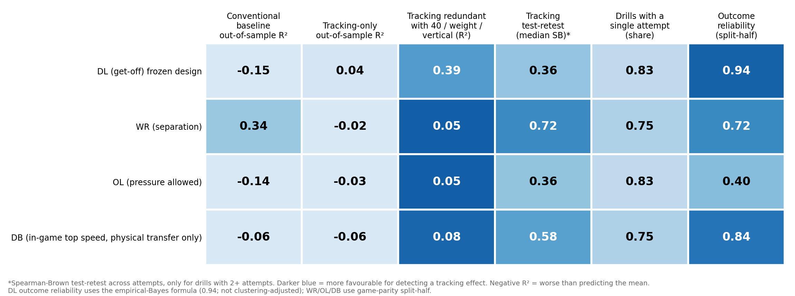

## Summary

**Question.** Combine sensor tracking records *how* a prospect moves, not just how long a drill takes. Does that movement information help predict NFL performance beyond what scouts already have: the stopwatch times, body measurements and draft slot?

**Answer, under the design we tested.** We found **no detectable incremental out-of-sample information from Combine-tracking kinematics in any of four position groups** (defensive line, wide receiver, offensive line, defensive back). For each group we also report how large a gain the data can rule out. This is a bounded null, not proof that tracking is useless: we tested four coarse kinematic composites on roughly 60 players per group.

**What we link.** Each Combine drill attempt (10 Hz x/y tracking) is turned into movement features and linked, player by player, to regular-season NFL game tracking and play-level outcomes for the same players.

## Why a pre-registered audit

Combine analyses typically test many drill-outcome pairs and report the survivors. With about 60 players per position that is a recipe for false positives. We instead fixed the hypotheses, features, outcomes, models and the multiple-testing family in dated, hashed plan files **before** computing any association, froze the first analysis (DL) as an anchor, and labelled everything run afterwards as post hoc. Plan files, hashes and code are in the notebook and appendix.

## Data and measurement checks

- Regular-season, non-nullified plays only (the data also contains preseason and playoff games, which we excluded). A player needs at least 100 qualifying snaps.
- The supplied Combine acceleration column is a non-negative magnitude, so it cannot measure braking. We recompute velocity and longitudinal acceleration from x/y positions.
- **Tracking vs stopwatch.** Tracked 40-yard time agrees with the official time (r = 0.95, n = 381 players, constant offset of about 0.13 s). A standard sprint model's top speed correlates with the official 40 time at about −0.95: the stopwatch 40 is essentially a top-speed test, so tracked top speed adds little. The model's acceleration constant has a test-retest correlation of only 0.36.
- **In-game outcome check.** Our tracking-derived first-second advance after the snap correlates −0.90 with the NFL's `player_get_off` (33,369 DL snaps).

## Design

For each group, an outcome is adjusted for role and context at the snap level, then shrunk to a player-level estimate (empirical Bayes):

- **DL:** time to cross the line of scrimmage (get-off), adjusted for alignment, pass vs run and season.
- **WR:** separation at pass-forward, adjusted for route, alignment, coverage type, cushion and season.
- **OL:** pressure allowed vs expected, from a logistic model of pass-block snaps (alignment, down, distance, formation, coverage, season).
- **DB:** in-game peak speed during pass coverage (a *physical-transfer* outcome). We could not define a defender-level **coverage-performance** outcome: the data link no completion, target or yards-allowed to a defender, so we do not report one.

Predictors are four tracking composites (peak speed, peak acceleration, peak braking, maximum turn rate), z-scored within drill and averaged across each group's drills with at least 80% coverage (WR 12 drills, OL 6, DB 8, DL 6). The conventional baseline is the 11 standard measurements (40, 10-yard split, 3-cone, shuttle, vertical, broad jump, height, weight, arm length, wingspan, log draft pick). The enhanced model adds the four composites.

**Validation.** Leave-one-draft-class-out: train on two classes, predict the third, so no player appears on both sides. Ridge regression with the penalty chosen by inner cross-validation. **Estimand:** the change in out-of-sample R² from adding tracking. Uncertainty: 95% player-level bootstrap interval. Test: one-sided permutation test, Benjamini-Hochberg-corrected across the four groups. **Pre-set practical threshold:** a gain of +0.10 R².

## Results

**Table 1. Incremental value of tracking (leave-one-class-out).**

| Group | Players | Snaps | R² conventional | R² + tracking | Δ R² [95% CI] | BH p |
|---|---|---|---|---|---|---|
| DL (get-off, frozen anchor) | 66 | 30,191 | −0.152 | −0.207 | −0.056 [−0.176, +0.057] | 0.70 |
| WR (separation) | 59 | 27,380 | 0.338 | 0.320 | −0.018 [−0.054, +0.016] | 0.70 |
| OL (pressure allowed) | 66 | 47,835 | −0.140 | −0.130 | +0.010 [−0.051, +0.078] | 0.70 |
| DB (in-game top speed) | 62 | 24,809 | −0.061 | −0.077 | −0.016 [−0.046, +0.010] | 0.70 |

**Figure 1.** Change in out-of-sample R² from adding tracking composites. All intervals include zero and lie below +0.10, so a practically useful gain is excluded under this design.

Negative R² means the model predicted worse than the group mean. For DL, OL and DB the pre-specified conventional baseline did not beat the group mean out of sample (a post hoc nested-penalty re-evaluation of DL gave a small positive baseline R² of 0.045 and Δ = +0.014 [−0.017, +0.048], still no detectable gain).

## Why the nulls differ

**Figure 2** shows what could and could not be tested in each group.

- **WR is the cleanest null.** Conventional measures do carry signal (R² 0.34; weight ρ = −0.62 and height ρ = −0.46 with adjusted separation, possibly a role proxy that we did not test). The tracking composites are not redundant with the 40, weight and vertical (R² 0.05) and are reasonably reliable (median test-retest 0.72), yet they add nothing.
- **DL:** the speed composite largely duplicates the stopwatch; acceleration and braking features are weakly reliable (median 0.36), and five of six drills have no estimable retest.
- **OL is the least informative test.** The outcome is noisy (game-parity split-half reliability 0.40) and tracking features are weakly reliable (median 0.36).
- **DB:** neither conventional nor tracking measures explain in-game coverage top speed, which may be dominated by assignment and role (not tested).

## What this means for scouting

- Do not expect tracked top speed to replace the stopwatch 40; they carry essentially the same information.
- Treat single-attempt, drill-level sensor kinematics (acceleration, braking, turning) as noisy: 75-83% of the drills we used have no estimable retest (mostly a single attempt per player), so their reliability cannot even be checked. Standardized, repeated, max-effort reps would be needed before such numbers are used for evaluation.
- Judge claims of tracking "signals" by out-of-sample, held-out-class evidence with effect bounds, not by the best of many correlations.

## Limitations

About 60 players per group and three draft classes; the 2023 class has up to three NFL seasons and 2025 only one; four coarse composites (drill-specific or phase-specific features were not tested); outcomes depend on role, scheme and quarterback; selection into playing time; DB outcome is physical, on plays with a pass, not coverage performance; confidence intervals resample fixed out-of-sample predictions (an approximation). A simulation (synthetic data, n = 66) shows that even a single well-measured feature (reliability 0.8) with a true incremental R² of 0.10 would be detected only about 60% of the time, so modest real effects could remain undetected. Two non-confirmatory sensitivity intervals excluded zero (WR rookie-season-only: tracking worse; OL best-attempt composites: +0.08); we treat both as exploratory, not findings. Our results agree with, but do not add to, independent public findings that tracked top speed is redundant with the 40 and that position-drill kinematics are unreliable.

## Reproducibility

The attached public notebook rebuilds every number and figure from the competition files. The plan files (original DL plan and the four-group plan) carry SHA-256 hashes and the analysis script refuses to run if the plan file changed. Unit and integration tests cover joins, outcome construction, validation splits and statistics.
